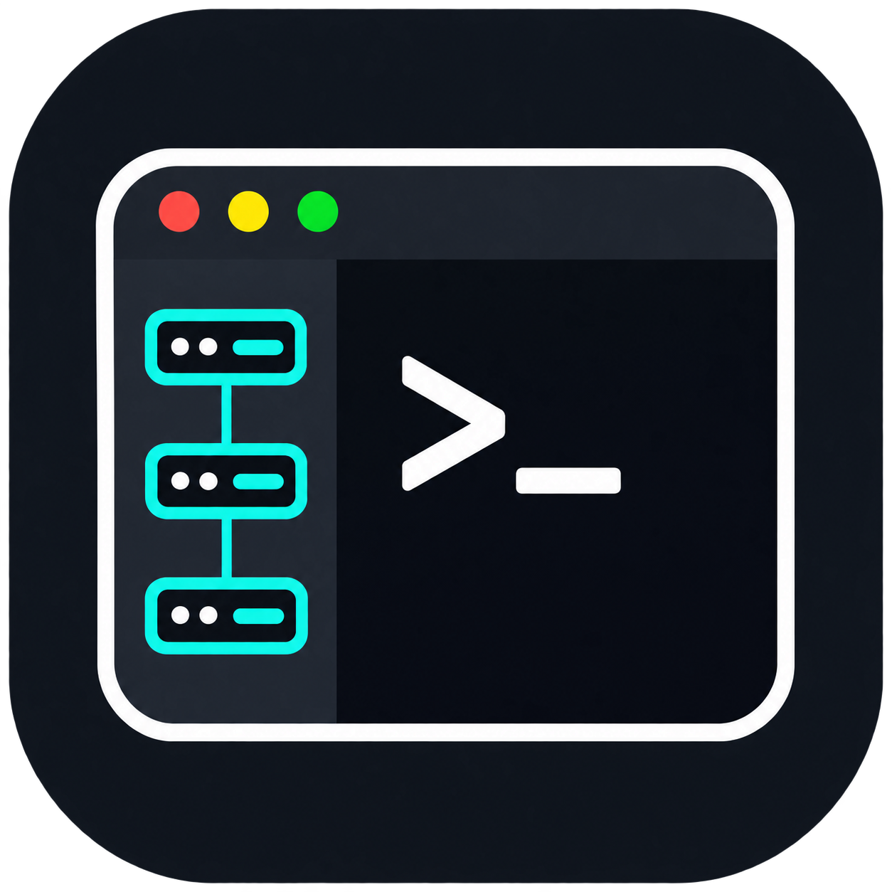
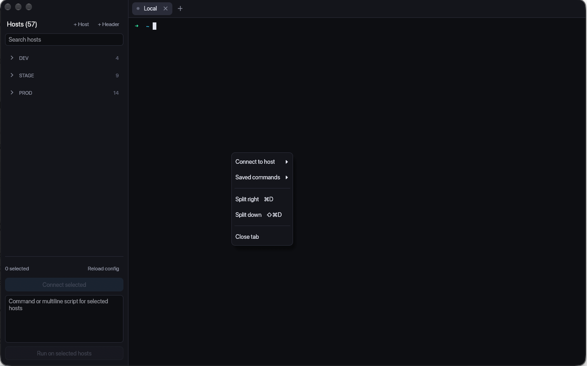

# ShellHopper

<p align="center">
  
</p>

<p align="center">
  <strong>Your servers are organized. Your terminal should be too.</strong>
</p>

ShellHopper is a native macOS terminal built for developers, administrators, and operators who manage more servers than a row of unlabeled terminal tabs can reasonably handle.

It turns your existing OpenSSH configuration into a visual workspace: group hosts by environment or purpose, connect without hunting for aliases, run commands across selected servers, and keep every result in its own clearly named session. Your normal shell, keys, agent, aliases, and `ProxyJump` configuration keep working exactly where you expect them to.

<p align="center">
  
</p>

## Download

Download the latest signed and notarized universal DMG from [GitHub Releases](https://github.com/nickcheek/ShellHopper/releases). It supports Apple silicon and Intel Macs running macOS 13 or newer.

Open the DMG, then drag ShellHopper into Applications. No account or setup wizard is required.

## Built for server sprawl

ShellHopper is most useful when “just SSH into it” has become fifty aliases spread across development, staging, production, client environments, cloud accounts, and a home lab you definitely meant to document.

- **See the fleet before connecting.** Import `~/.ssh/config`, arrange hosts under collapsible headers, reorder them, and add separators where they help.
- **Run one task across selected servers.** Select the hosts you need, enter a command or multiline script, and run it without manually opening every connection first.
- **Keep output understandable.** Each server gets its own managed tab, and later commands reuse the correct session instead of creating tab number seventeen.
- **Build the workspace you need.** Keep servers in reorderable tabs, split any pane right or down, and nest additional splits to watch or operate several sessions at once.
- **Save the commands you actually repeat.** Shared saved commands are available from every terminal's right-click menu.
- **Stay in control.** Choosing a saved command only pastes it. ShellHopper never presses Enter for you, so you can inspect or change it before anything runs.
- **Use the SSH setup you already trust.** Keys, agents, aliases, ports, users, identity files, and jump hosts remain in OpenSSH rather than another proprietary vault.

## What makes ShellHopper different

ShellHopper is not trying to replace the shell with a dashboard or turn terminal work into a cloud service. It adds organization around the terminal while keeping the terminal itself familiar.

### Organized hosts, not memorized aliases

Your SSH hosts live in a searchable sidebar with collapsible, reorderable groups. Organize them by environment, application, customer, cloud account, or whatever matches the way you actually think about the infrastructure.

Double-click a host to open a managed SSH tab, connect the current pane from its context menu, or launch a saved host directly from the macOS menu bar.

### Multi-server work without mixed output

Select several hosts in the sidebar and send them one command or a multiline script. ShellHopper opens or reuses one managed tab per host, waits for each SSH connection to be ready, and keeps the output separated by server.

That makes routine work—checking versions, inspecting service status, reviewing disk usage, or applying the same safe change across a group—faster without sacrificing visibility.

### Tabs and split panes built for real operations

Every local or SSH session can live in its own named tab, and tabs can be reordered, renamed, reopened, or closed in groups. When you need several sessions visible together, split any terminal pane to the right or downward.

Splits are fully nestable, so one tab can hold the exact working layout you need: production beside staging, a log stream above a command shell, or several related servers visible at the same time. Each pane remains an independent terminal and can connect to a different saved host from its right-click menu.

ShellHopper restores the tab order and complete nested split layout after restarting, while restored SSH panes remain safely disconnected until you choose to reconnect them.

### Saved commands with a safety catch

Right-click any terminal and choose **Saved commands** to paste a shared command into that pane. Review it, edit it if needed, and press Enter when you are ready.

Choose **Manage saved commands…** to add, rename, reorder, or remove commands. Entries are limited to one line so a saved command cannot conceal an embedded Enter.

### A complete terminal, not a limited SSH console

- Local login shells using your real shell configuration, including Oh My Zsh.
- Tabs and recursively nested split panes that preserve independent terminal sessions.
- Truecolor, alternate screens, mouse reporting, bracketed paste, application cursor keys, and scrollback.
- Proper support for interactive tools such as `vim`, `less`, history search, and terminal mouse applications.
- Searchable terminal output and a command list for the current session.
- A command editor in local zsh tabs with word selection, type-to-replace, cut, copy, and paste. SSH panes and other shells keep standard terminal input for now. Long lines wrap at the pane edge; turn that off with **ShellHopper › Settings › Word Wrap** to keep each line on one row and scroll sideways instead.
- Command-clickable URLs and local paths.

### Practical Mac integration

- Open or return to saved hosts from the menu bar.
- Drop local files onto a connected SSH pane to upload them to that server's home directory.
- Restore tab order, nested splits, host order, collapsed groups, and sidebar organization after restarting.
- Reopen the last closed tab when “I definitely meant to close that” turns out to be inaccurate.

## The basic workflow

1. Launch ShellHopper and import the usable entries from `~/.ssh/config`.
2. Arrange hosts into groups such as Development, Staging, Production, Clients, or Home Lab.
3. Double-click one host for an interactive session, or select several hosts for a shared task.
4. Enter a command or multiline script and choose **Run on selected hosts**.
5. Review each server's output in its own tab and continue working in the open sessions.

## Deliberately local

ShellHopper has no account, subscription, telemetry, cloud sync, or AI running in the app. There is no separate credential store to maintain and no service that needs to remain available before you can reach your servers.

It saves host organization, saved commands, and safe interface state here:

```text
~/Library/Application Support/ShellHopper/config.toml
```

It does **not** store passwords, terminal output, environment variables, SSH credentials, pending commands, or scrollback. Authentication remains with your SSH configuration, keys, agent, and interactive prompts.

Saved commands are plain text. They are intended for repeatable shell commands—not passwords, tokens, or other secrets. Restored SSH panes start disconnected and reconnect only when you request it or send a multi-host command to that server.

An existing TermiSlop configuration is copied into the new location on first launch, and the old file is left untouched.

## Keyboard shortcuts

| Shortcut | Action |
| --- | --- |
| `⌘T` | Open a local terminal |
| `⌘W` | Close the active pane or tab |
| `⌘⇧T` | Reopen the last closed tab |
| `⌘1`–`⌘8` | Switch to a numbered tab |
| `⌘9` | Switch to the last tab |
| `⌘⇧[` / `⌘⇧]` | Switch tabs |
| `⌘F` | Search terminal output |
| `⌘L` | Search, copy, or paste commands from the current session |
| `⌘K` | Clear the active terminal and scrollback |
| `⌘D` | Split the active pane right |
| `⌘⇧D` | Split the active pane down |
| `⌘A` | Select the command editor's text, or all terminal output when the editor is empty or a program is running |
| `↑` / `↓` | Step through this session's commands in the command editor |
| `⇧Enter` | Add a line to the command in the command editor |
| `Tab` | Hand the typed command to zsh for completion |
| `⌘↓` | Return to live output |
| `⇧Page Up` / `⇧Page Down` | Move through scrollback |
| `⌘` + click a URL or local path | Open it with the default macOS app |
| Shift + drag | Select text when a terminal program owns the mouse |

## Build from source

Building requires macOS and a current stable Rust toolchain.

```sh
git clone https://github.com/nickcheek/ShellHopper.git
cd ShellHopper
cargo build --release
./target/release/shellhopper
```

## Package a release

The packaging script builds a universal app for Apple silicon and Intel Macs, signs it with hardened runtime, creates a DMG, submits it to Apple for notarization, staples the approval ticket, and verifies the finished download.

```sh
DEVELOPER_ID_APPLICATION="Developer ID Application: Your Name (TEAMID)" \
NOTARY_PROFILE="ShellHopper-notary" \
./scripts/package-macos.sh
```

The finished disk image and its SHA-256 checksum are written to `dist/`. Upload both files to the GitHub release so installed copies can verify and download the update. Signing requires a Developer ID Application certificate, and `NOTARY_PROFILE` must name credentials stored with `xcrun notarytool store-credentials`.

## Local SSH fixture

The opt-in Docker/OpenSSH fixture under [`tests/fixtures/ssh`](tests/fixtures/ssh/README.md) binds to a random loopback port and creates disposable keys and configuration under `/tmp`. It does not modify your real SSH config or `known_hosts` file.

```sh
./tests/fixtures/ssh/start.sh
./tests/fixtures/ssh/stop.sh
```

## Contributing

Bug reports should include what you did, what you expected, what happened, and enough detail to reproduce it. Screenshots and exact SSH configuration relationships are especially helpful. Small pull requests that solve one real problem are much easier to review than ambitious plans to reinvent the terminal.

## License

ShellHopper is available under the [MIT License](LICENSE).
